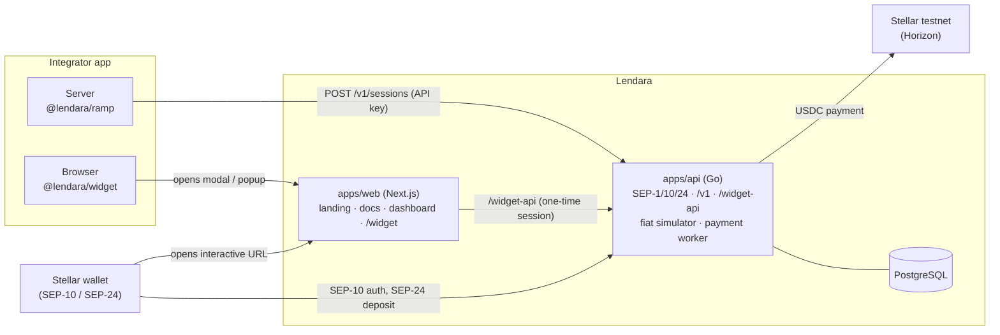
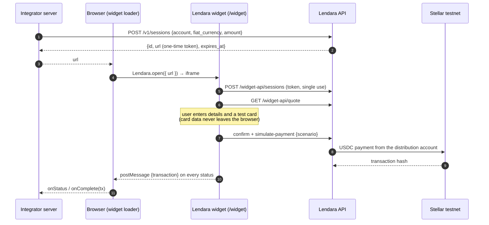

# Lendara Sandbox

[](https://github.com/Lendara-Org/Lendara-monorepo/actions/workflows/ci.yml)
[](https://www.npmjs.com/package/@lendara/ramp)
[](https://www.npmjs.com/package/@lendara/widget)
[](LICENSE)

**An embeddable local currency → USDC on-ramp on Stellar, for Costa Rica (CRC), Argentina (ARS) and Chile (CLP).**
Think "Stripe Checkout for Stellar": a project gets an API key, embeds a widget in a few lines, and its users pay in
their local currency and receive USDC in their Stellar wallet.

This repository is the **sandbox**: a real Stellar anchor running on **testnet** with **simulated fiat rails**. No real
money moves and no license is needed, so anyone can integrate it and test every path, including failures, with test
cards.

> Stellar Chile hackathon submission · October 2026

---

## Contents

- [Live links](#live-links)
- [Try it in 5 minutes](#try-it-in-5-minutes)
- [The problem](#the-problem)
- [What Lendara does](#what-lendara-does)
- [Architecture](#architecture)
- [How a deposit works](#how-a-deposit-works)
- [Sandbox scenarios](#sandbox-scenarios)
- [Integrating](#integrating)
- [Security](#security)
- [Sandbox vs. production](#sandbox-vs-production)
- [Repository layout](#repository-layout)
- [Tech stack](#tech-stack)
- [Run it locally](#run-it-locally)
- [Testing and quality](#testing-and-quality)
- [Deploy](#deploy)
- [Validation](#validation)
- [Roadmap](#roadmap)
- [Team](#team)
- [Contributing](#contributing)
- [License](#license)

---

## Live links

| What | URL |
|---|---|
| Landing (es / en) | https://lendara-monorepo-fixh.vercel.app |
| Docs (es / en) | https://lendara-monorepo-fixh.vercel.app/docs |
| Developer dashboard | https://lendara-monorepo-fixh.vercel.app/dashboard |
| Demo app that integrates Lendara | https://lendara-monorepo.vercel.app |
| API | https://lendaraweb-production.up.railway.app |
| `stellar.toml` (SEP-1) | https://lendara-monorepo-fixh.vercel.app/.well-known/stellar.toml (home domain; also served by the API) |
| npm | [`@lendara/ramp`](https://www.npmjs.com/package/@lendara/ramp) · [`@lendara/widget`](https://www.npmjs.com/package/@lendara/widget) |

The API runs on Railway's free plan, which sleeps when idle: the first request after a while can take a few seconds.

---

## Try it in 5 minutes

### A. As a user (no setup)

1. Open the **[demo app](https://lendara-monorepo.vercel.app)** and click **Create a test wallet**. The demo creates a
   testnet account with Friendbot and adds the USDC trustline.
2. Pick a currency and an amount, then **Add funds**. The Lendara widget opens over the page.
3. Fill in any name and email, and pay with the test card **`4242 4242 4242 4242`** (any future date, any CVC).
4. Watch the status change live. In a few seconds the USDC arrives: the demo shows the received amount, the updated
   balance and a link to the transaction on [Stellar Expert](https://stellar.expert/explorer/testnet).

Try the other [test cards](#sandbox-scenarios) to see a KYC rejection, an expired payment or a delayed one.

### B. As a developer

1. Open the **[dashboard](https://lendara-monorepo-fixh.vercel.app/dashboard)**, create a project and copy the API key
   (`lnd_test_…`). It's shown only once.
2. Create a session from your terminal (replace the account with a testnet account that trusts Lendara's USDC, e.g. one
   created in the demo):

   ```bash
   curl -X POST https://lendaraweb-production.up.railway.app/v1/sessions \
     -H "Authorization: Bearer lnd_test_…" \
     -H "Content-Type: application/json" \
     -d '{"account":"G…","fiat_currency":"CRC","amount":"25000"}'
   ```

3. Open the returned `url` in the browser and pay with a test card.
4. Back in the dashboard, the transaction shows up with its status and Stellar hash.

The [quickstart](https://lendara-monorepo-fixh.vercel.app/docs/en/quickstart) shows the same flow with the SDK and the
widget.

### C. As a Stellar wallet

Any SEP-24 wallet can use Lendara with no extra code. With the
[SDF Demo Wallet](https://demo-wallet.stellar.org) on testnet, add the asset `USDC` with the home domain
`lendara-monorepo-fixh.vercel.app`, add the trustline and start a **SEP-24 deposit**. See
[For wallets](https://lendara-monorepo-fixh.vercel.app/docs/en/wallets).

---

## The problem

Getting local money into Stellar is hard for small projects in Latin America:

- The few embeddable on-ramps belong to large players and aren't built for small teams or for currencies like the
  Costa Rican colón.
- Integrating an anchor directly means learning SEP-1, SEP-10 and SEP-24, handling an interactive flow and following
  transaction statuses by hand.
- There is no easy way to **test** the unhappy paths (rejected KYC, payments that never arrive) before going live.

## What Lendara does

Lendara speaks to two kinds of clients with **one transaction model and one status machine**:

| You are… | You use | Auth |
|---|---|---|
| An app or dApp (not a wallet) | The Lendara API: `@lendara/ramp` on your server and `@lendara/widget` in the browser | Project API key |
| A Stellar wallet | Standard anchor endpoints: SEP-1, SEP-10 and SEP-24 | SEP-10 (JWT) |

On top of that, the sandbox adds what a developer needs to integrate with confidence:

- **Test cards** that force each outcome, like Stripe's test mode.
- A **dashboard** to create projects, get an API key and watch transactions.
- **Bilingual docs** (Spanish and English) with a quickstart.
- A **demo app** that shows the whole integration in two snippets.

---

## Architecture



- **`openapi.yaml` is the contract.** Go server types (`oapi-codegen`) and TypeScript types (`openapi-typescript`) are
  generated from it, so the API, the SDK and the widget never drift apart. CI fails if generated code is stale.
- **The widget is not a separate app**: it's the `/widget/[id]` route of `apps/web`. `@lendara/widget` is a small
  loader that opens that URL in an iframe (modal) or a popup and relays its events.
- **One status machine** (`apps/api/internal/transaction`): every transition is validated and recorded in
  `transaction_events`. SEP-24 and `/v1` read the same rows.
- **Payment worker**: a goroutine inside the API process picks deposits waiting for USDC, checks the trustline and
  submits the payment to Horizon. No external queue.

## How a deposit works



### Statuses

Transactions follow the SEP-24 statuses:

```
incomplete → pending_user_transfer_start → pending_anchor → pending_stellar → completed
                          ↘ expired               ↘ pending_trust (no USDC trustline, retried for 1 h)
any status → error
```

---

## Sandbox scenarios

The widget accepts only these Visa test cards (validated with Luhn). It maps the card to a scenario **in the browser**
and sends only the scenario name to the API.

| Test card | Scenario | Result |
|---|---|---|
| `4242 4242 4242 4242` | `approved` | USDC sent → `completed` |
| `4000 0000 0000 0002` | `kyc_rejected` | `error` ("KYC rejected") |
| `4000 0000 0000 9995` | `payment_not_received` | `expired` |
| `4000 0000 0000 0077` | `delayed` | 30 s in `pending_anchor`, then `completed` |

**Rates, fee and limits** (fictitious, in `apps/api/internal/sandbox`):

| | |
|---|---|
| Rates per 1 USDC | CRC 510 · ARS 1,000 · CLP 950 |
| Fee | 0.50 USDC, fixed |
| Limits | 1 to 10,000 USDC per deposit, after the fee |
| Fiat amounts | Decimal strings, up to 2 decimals |
| USDC amounts | Rounded down to 7 decimals (Stellar precision) |

---

## Integrating

### Apps: SDK + widget

```bash
npm i @lendara/ramp @lendara/widget
```

```ts
// Server: the API key never reaches the browser.
import { LendaraRamp } from "@lendara/ramp";

const lendara = new LendaraRamp({ apiKey: process.env.LENDARA_API_KEY! });

export async function POST(req: Request) {
  const { account, fiat_currency, amount } = await req.json();
  const session = await lendara.createSession({ account, fiat_currency, amount });
  return Response.json({ url: session.url });
}
```

```ts
// Browser
import { Lendara } from "@lendara/widget";

Lendara.open({
  url,                         // from your server
  mode: "modal",               // or "popup"
  onStatus: (tx) => console.log(tx.status),
  onComplete: (tx) => showReceipt(tx),
  onError: (err) => showError(err.message),
  onClose: () => {},
});
```

### Lendara API (`/v1`)

Send `Authorization: Bearer lnd_test_…`.

| Endpoint | Description |
|---|---|
| `POST /v1/projects` | Create a sandbox project; returns the API key once. No auth. |
| `GET /v1/project` | The project of the API key. |
| `POST /v1/sessions` | Create a deposit in `incomplete`; returns `{ id, url, expires_at }`. `fiat_currency` and `amount` are optional and prefill the widget. |
| `GET /v1/transactions` | The project's transactions, newest first. `limit` (1–100) and `cursor` pagination. |
| `GET /v1/transactions/{id}` | One transaction (SEP-24 schema). Other projects' transactions return 404. |

Errors are JSON `{ "error": "…" }` with `400`, `401` or `404`.

### Wallets: SEP-1, SEP-10, SEP-24

| SEP | Endpoints |
|---|---|
| SEP-1 | `GET /.well-known/stellar.toml` (generated from config, CORS `*`) |
| SEP-10 | `GET /auth?account=G…` (challenge) · `POST /auth` (JWT, 24 h) |
| SEP-24 | `GET /sep24/info` · `POST /sep24/transactions/deposit/interactive` (JSON, form or multipart) · `GET /sep24/transaction` · `GET /sep24/transactions` |

SEP-10 uses the official Go SDK helpers (no hand-written crypto). Accounts `G…`, muxed `M…` and `G…:memo` subjects are
supported, as are `text`, `id` and `hash` memos. Deposits only for now.

The full contract, including the internal `/widget-api` used by the widget, is in [`openapi.yaml`](openapi.yaml).

---

## Security

- **API keys are stored hashed** (SHA-256 of a 128-bit random key) and shown only once. The dashboard keeps the key in
  the developer's own browser.
- **Interactive URLs carry a one-time token** (hashed in the database, single use, 15 minutes). The widget exchanges it
  for a 30-minute session JWT scoped to one transaction, and removes it from the address bar.
- **Card data never leaves the browser.** The widget accepts only published test cards and sends only the scenario.
  Card inputs use `autocomplete="off"` so browsers don't offer real cards.
- **The loader checks `postMessage` origin and source**: it only accepts messages from the widget's origin and window.
- The widget page sends `Referrer-Policy: no-referrer` and `Cache-Control: no-store`.
- **Testnet only.** Secrets live in environment variables; `gitleaks` runs in CI with a rule for Stellar secret seeds.
- `govulncheck` scans Go dependencies in CI.

---

## Sandbox vs. production

| | Sandbox (this repo) | Production (future) |
|---|---|---|
| Network | Stellar testnet | Stellar mainnet |
| Fiat | Simulated; the test card decides the outcome | Local payment rails (bank transfers, cards) |
| USDC | Lendara's **own test asset** called `USDC` | **Circle's USDC**, delivered from Lendara's inventory |
| Rates and fee | Fixed and fictitious | Market rates plus a fee |
| KYC | Simulated by a test card | Real KYC provider |
| Licenses | Not needed | Required in each country |

**About USDC.** On Stellar an asset is identified by its code **and issuer**. The sandbox issues its own test asset
named `USDC` (issuer `GBVIQ7QVTTJ4NLFTYYFPEKWYJWAMKDAOFYSR52ZGWJFSGTSVOO5H47B5`, marked `status = "test"` in
`stellar.toml`) so liquidity never runs out during tests. It's not Circle's USDC and has no value. To receive it, an
account needs a trustline to that exact issuer.

In production Lendara would **not issue USDC**: only Circle does. Lendara would receive local currency and deliver
Circle USDC from its own inventory, bought through Circle or exchanges, earning a fee.

---

## Repository layout

```
.
├── apps/
│   ├── api/                  # Go: SEP-1/10/24, /v1, /widget-api, fiat simulator, payment worker
│   │   ├── cmd/api/          #   HTTP server entrypoint
│   │   ├── cmd/setup-testnet/#   creates and funds testnet accounts, issues test USDC (idempotent)
│   │   ├── internal/
│   │   │   ├── api/          #   generated from openapi.yaml (oapi-codegen, strict server)
│   │   │   ├── db/           #   generated from SQL (sqlc) + queries/*.sql
│   │   │   ├── handlers/     #   endpoint implementations
│   │   │   ├── payment/      #   worker that sends USDC on Stellar
│   │   │   ├── project/      #   projects and hashed API keys
│   │   │   ├── sandbox/      #   rates, fee, limits, scenarios
│   │   │   ├── sep1/ sep10/  #   stellar.toml and web authentication
│   │   │   ├── server/       #   routing, auth middleware, CORS, logging (+ integration tests)
│   │   │   ├── transaction/  #   status machine and store
│   │   │   └── widgetauth/   #   widget session tokens
│   │   ├── migrations/       #   goose SQL migrations
│   │   └── Dockerfile
│   ├── web/                  # Next.js: landing (/es, /en), /docs, /dashboard, /widget/[id]
│   └── demo/                 # Next.js: example app that integrates Lendara
├── packages/
│   ├── sdk/                  # @lendara/ramp: server-side client, types generated from openapi.yaml
│   └── widget/               # @lendara/widget: loader that opens the widget (modal or popup)
├── openapi.yaml              # API contract: source of truth
├── docker-compose.yml        # local PostgreSQL
├── Makefile                  # root commands
└── .env.example
```

## Tech stack

| Layer | Choices |
|---|---|
| API | Go 1.27, `net/http`, [`oapi-codegen`](https://github.com/oapi-codegen/oapi-codegen) (strict server), `pgx` + [`sqlc`](https://sqlc.dev), [`goose`](https://github.com/pressly/goose) migrations, `log/slog`, `golang-jwt` |
| Stellar | [`github.com/stellar/go-stellar-sdk`](https://github.com/stellar/go-stellar-sdk) (SEP-10 helpers, `txnbuild`, Horizon client); `@stellar/stellar-base` in the demo |
| Database | PostgreSQL 17 |
| Web | Next.js 16 (App Router), React 19, TypeScript (strict), Tailwind CSS 4 |
| Packages | TypeScript, built with `tsc`, no runtime dependencies |
| Tooling | pnpm workspaces, Make, Docker Compose, golangci-lint, govulncheck, ESLint, Redocly, commitlint, lefthook, gitleaks |
| Hosting | Railway (API + Postgres), Vercel (web and demo) |

---

## Run it locally

### Requirements

- Node.js 20+ with Corepack (it pins pnpm from `packageManager`)
- Go 1.27+
- Docker with Compose

### Steps

```bash
cp .env.example .env
make install          # pnpm install (also sets up git hooks)
make db-up            # PostgreSQL in Docker
make migrate          # apply migrations

# Generate the SEP-10 secret and put it in .env
openssl rand -hex 32  # → SEP10_JWT_SECRET

# Create the testnet accounts (issuer, distribution, signing key) and issue test USDC.
make setup-testnet    # paste its output into .env

make dev-api          # API on http://localhost:8080 (check /health)
make dev-web          # web on http://localhost:3000
```

To run the demo app locally, create a project against your local API and pass its key:

```bash
curl -s -X POST localhost:8080/v1/projects -H 'Content-Type: application/json' -d '{"name":"Local demo"}'
# put the api_key in .env as LENDARA_API_KEY, with LENDARA_API_BASE_URL=http://localhost:8080
make dev-demo         # demo on http://localhost:3001
```

### Environment variables

| Variable | Used by | Description |
|---|---|---|
| `DATABASE_URL` | API | PostgreSQL connection string. |
| `PORT` | API | HTTP port (default `8080`). |
| `API_BASE_URL` | API | Public URL of the API (used in `stellar.toml` and tokens). |
| `WEB_BASE_URL` | API | Public URL of the web app (interactive widget URLs). |
| `SEP10_JWT_SECRET` | API | Signs SEP-10 and widget session JWTs. At least 32 characters. |
| `STELLAR_HORIZON_URL` | API, demo | Horizon testnet URL. |
| `STELLAR_HOME_DOMAIN` | API, `setup-testnet` | Comma-separated home domains accepted by SEP-10 (where `stellar.toml` is served). The first one is the default and is set on the issuer account, so it must have at most 32 characters. |
| `STELLAR_ISSUER_PUBLIC_KEY` | API, demo | Issuer of the test USDC. |
| `STELLAR_ISSUER_SECRET` | `setup-testnet` | Only to issue USDC. Not needed by the API. |
| `STELLAR_DISTRIBUTION_SECRET` | API | Account that sends USDC to users. |
| `STELLAR_SIGNING_SECRET` | API | SEP-10 signing key (`SIGNING_KEY` in `stellar.toml`). |
| `LOG_LEVEL` | API | `debug`, `info`, `warn` or `error`. |
| `NEXT_PUBLIC_API_BASE_URL` | web | API URL, inlined at build time. |
| `LENDARA_API_KEY` | demo | Project API key (server only). |
| `LENDARA_API_BASE_URL` | demo | Optional; defaults to the public sandbox API. |
| `TEST_DATABASE_URL` | tests | Enables the Go integration tests. |

### Commands

| Command | What it does |
|---|---|
| `make dev-api` / `make dev-web` / `make dev-demo` | Run the API, the web app or the demo |
| `make lint` | ESLint, golangci-lint, `go mod tidy -diff` and Redocly (OpenAPI) |
| `make typecheck` | TypeScript in every package |
| `make test` | JS tests (`node:test`) and Go tests (integration tests need `TEST_DATABASE_URL`) |
| `make build` | Build every package and app |
| `make codegen` | Regenerate Go and TS code from `openapi.yaml` and SQL |
| `make vuln-api` | Scan Go dependencies with `govulncheck` |
| `make migrate` / `make migrate-down` / `make migrate-status` | Manage DB migrations |
| `make setup-testnet` | Create/fund testnet accounts and issue test USDC (idempotent) |

Go tools (`goose`, `golangci-lint`, `govulncheck`, `oapi-codegen`, `sqlc`) are pinned in `apps/api/tools.mod` and run
with `go tool`: nothing to install globally.

---

## Testing and quality

- **Go:** unit tests for the status machine, quotes and scenarios; SEP-10 (invalid challenge requests, new and existing
  accounts, memos, challenges from another server, Horizon failures, invalid and expired JWTs); `stellar.toml` (round
  trip, no secrets in the output); the payment worker (completed, waiting for a trustline, deadline, Horizon errors and
  retries, memos). Integration tests against PostgreSQL for SEP-24, `/widget-api` and `/v1` (auth, sessions,
  pagination, project isolation).
- **TypeScript:** `node:test` suites for the SDK client and the widget message parser.
- **End to end:** deposits were run on testnet through the deployed web, API and demo with Playwright (all four test
  cards, modal and popup modes, desktop and mobile).
- **CI** (GitHub Actions) on every PR: lint, typecheck, tests, build, `govulncheck`, migrations up/down, OpenAPI lint,
  generated code up to date, `gitleaks`, `actionlint` and Conventional Commits PR titles.

---

## Deploy

Both apps deploy from the **`develop`** branch.

### API + Postgres on [Railway](https://railway.com)

The service builds `apps/api/Dockerfile`. The image includes `goose`, which runs the migrations before each deploy.

1. New project → **+ Create → Database → PostgreSQL**.
2. Add a service from this repo. In its **Settings**:
   - **Root Directory:** `/apps/api`
   - **Dockerfile Path:** `/apps/api/Dockerfile`
   - **Custom Start Command:** empty (the image's entrypoint runs the API)
   - **Pre-deploy Command:** `/app/goose up`
   - **Healthcheck Path:** `/health`
   - **Source branch:** `develop`
3. **Variables** (raw editor):

   ```
   DATABASE_URL=${{Postgres.DATABASE_URL}}
   GOOSE_DBSTRING=${{Postgres.DATABASE_URL}}
   PORT=8080
   API_BASE_URL=https://<api-domain>
   STELLAR_HOME_DOMAIN=<web-domain>,<api-domain>
   WEB_BASE_URL=https://<web-domain>
   SEP10_JWT_SECRET=<openssl rand -hex 32>
   STELLAR_ISSUER_PUBLIC_KEY=<G...>
   STELLAR_DISTRIBUTION_SECRET=<S...>
   STELLAR_SIGNING_SECRET=<S...>
   ```

   The issuer secret is only needed by `make setup-testnet`; don't upload it.
4. **Settings → Networking → Generate Domain** on port `8080`.

If a merge doesn't trigger a deploy, use **Deploy latest commit** (not *Redeploy*, which rebuilds the same old commit)
and check that the log shows the expected migrations. On the free plan, services are serverless and sleep when idle.

### Web on [Vercel](https://vercel.com)

Import the repo with root directory `apps/web` and set:

```
NEXT_PUBLIC_API_BASE_URL=https://<api-domain>
ENABLE_EXPERIMENTAL_COREPACK=1
```

Corepack makes Vercel use the pnpm version in `package.json`. `NEXT_PUBLIC_*` values are inlined at build time:
redeploy after changing them. In **Settings → Environments → Production → Branch Tracking**, use `develop`.

### Demo on Vercel

A second Vercel project from the same repo, with root directory `apps/demo` and:

```
LENDARA_API_KEY=<key from POST /v1/projects on the deployed API>
ENABLE_EXPERIMENTAL_COREPACK=1
```

### npm packages

```bash
npm login
pnpm --filter @lendara/ramp --filter @lendara/widget publish --no-git-checks
```

Publish with **pnpm**: in the monorepo, `exports` point to the TypeScript sources, and pnpm swaps in the
`publishConfig` that points to `dist`. Bump the version first; existing versions are skipped.

---

## Validation

Run against the deployed sandbox on 2026-10-12. Every payment below is a real testnet transaction you can open in
Stellar Expert.

| Check | Result |
|---|---|
| [SDF anchor test suite](https://github.com/stellar/stellar-anchor-tests) (`@stellar/anchor-tests` 0.6.22), SEP-1, 10 and 24 | ✅ SEP-1 5/5, SEP-10 16/16 and all 27 SEP-24 deposit tests pass. The 12 failures and 1 skip are withdrawal tests (deposits only for now). The tool's summary line reads 47 passed / 13 failed; its per-test output lists 48 ✔ and 12 ✖ |
| [SDF Demo Wallet](https://demo-wallet.stellar.org): SEP-10 + SEP-24 deposit with card 4242 | ✅ `completed`: [`330f8b2a…687b83`](https://stellar.expert/explorer/testnet/tx/330f8b2abb4b9f01d7cd1edf9d0dea6fdd924c6a0767ba416edde101fe687b83) (10,000 CRC → 19.1078431 USDC) |
| Deposit from the demo app (`/v1` + `@lendara/widget`) | ✅ `completed`: [`5ecead57…80eecde`](https://stellar.expert/explorer/testnet/tx/5ecead5705afc23cf4b4878932ab11169047b17c82faa196242a7b69580eecde) (25,000 CRC → 48.5196078 USDC) |
| SEP-24 deposit driven through the API (used by the anchor tests) | ✅ `completed`: [`7394f626…a9d0e51`](https://stellar.expert/explorer/testnet/tx/7394f626cf08684232fe9960711923d3824f831afaf6b46ad104e2589a9d0e51) (10,000 CRC → 19.1078431 USDC) |
| All four test cards | ✅ `completed`, `error`, `expired` and delayed `completed` |
| Widget in modal and popup, desktop and mobile | ✅ |

To run the anchor tests yourself:

```bash
npx @stellar/anchor-tests@0.6.22 -h https://lendara-monorepo-fixh.vercel.app -a USDC -s 1 10 24
```

The four SEP-24 tests for `pending_` and `completed` transactions need a `--sep-config` file with a funded testnet
account and two of its deposits (one pending, one completed); without it they are skipped.

---

## Roadmap

- Withdrawals (USDC → local currency, SEP-24).
- Webhooks for integrators (`transaction.updated`, HMAC-signed).
- SEP-12 (KYC) and SEP-38 (quotes).
- SEP-31 for anchor-to-anchor payments.
- Optional: Circle's testnet USDC in the sandbox, for wallets that already trust it.
- Production: licenses, real payment rails, mainnet and Circle USDC liquidity.

## Team

- **Anouk Rímola** (Costa Rica)
- **Elisa Araya** (Argentina)
- **Karen Giannetto** (Argentina)

## Contributing

- Branches: `<type>/<scope>-<description>` → PR to **`develop`** (squash). `develop` → `main` for releases.
- Commit messages and PR titles follow [Conventional Commits](https://www.conventionalcommits.org):
  `type(scope): subject`.
  - Types: `feat`, `fix`, `chore`, `docs`, `test`, `refactor`, `ci`.
  - Scopes: `api`, `web`, `sdk`, `widget`, `demo`, `repo`.
- `pnpm install` sets up a commit hook that validates the message; CI validates the PR title.
- If you change `openapi.yaml` or a SQL query, run `make codegen`.
- Before opening a PR: `make lint typecheck test build`.

## License

[MIT](LICENSE) © 2026 Lendara
